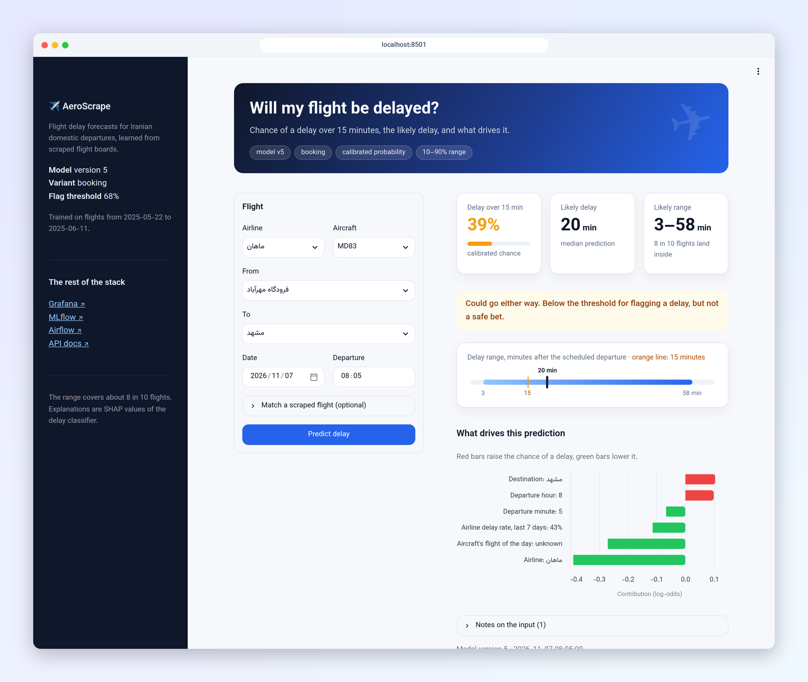
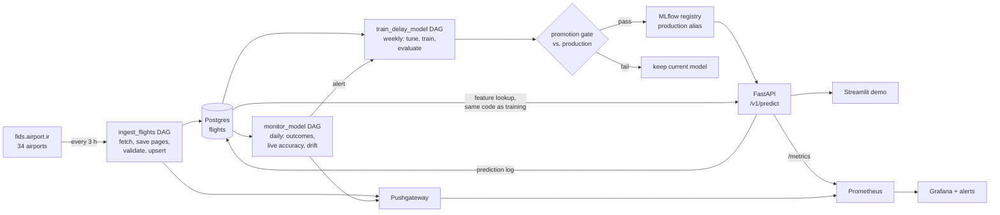

# AeroScrape

[](https://github.com/AminRezaeeyan/AeroScrape/actions/workflows/ci.yml)

Iranian domestic flights are often late: 60% of departures in our data left more than 15 minutes behind schedule. When you book or leave for the airport, the useful question is not "will it be late" but "how likely, by how much, and why". AeroScrape scrapes the public flight boards of 34 Iranian airports every three hours, learns from what actually happened, and answers that question for a given flight: a **calibrated probability of a delay over 15 minutes** and a **likely delay range** (the 10th to 90th percentile, which holds about 8 in 10 flights), with the factors behind it.

It is also a complete, small MLOps system: scraping with data contracts, a chronological evaluation against baselines, a promotion gate, a versioned API, and monitoring that compares live accuracy with the offline numbers and retrains when they drift apart.



## Results

Evaluated on a chronological split of the 2025 scrapes: model choices from rolling-origin cross-validation on 22 May to 9 June, tested once on 10 to 12 June (687 domestic departures, 26 airports). Changes are paired 95% bootstrap intervals against the best baseline (airline delay rate; airline × time-of-day median or percentiles). Two variants: one usable when the flight is booked, one an hour before departure, when the aircraft's previous delay is known.

| Model | MAE (min) | vs. baseline | 10–90% range coverage (target 80%) | Brier | vs. baseline |
| --- | --- | --- | --- | --- | --- |
| Best baseline | 24.7 | | 76.4% | 0.221 | |
| At booking | 24.0 | -0.7 [-1.2, -0.3] | 82.7% | 0.207 | -0.014 [-0.023, -0.005] |
| 1 h before departure | 23.0 | -1.7 [-2.6, -0.9] | 85.3% | 0.201 | -0.020 [-0.030, -0.011] |

Both variants beat the baselines on every metric, by modest margins. What each feature group adds, on the same test set (each row adds a group to the one above):

| Features | MAE (min) | Change | PR-AUC |
| --- | --- | --- | --- |
| calendar + identity | 23.8 | reference | 0.763 |
| + aircraft rotation | 23.8 | -0.0 [-0.3, +0.3] | 0.764 |
| + congestion | 24.1 | +0.3 [-0.2, +0.7] | 0.765 |
| + historical rates | 24.3 | +0.5 [-0.1, +1.0] | 0.764 |
| + live delay propagation | 23.2 | -0.6 [-1.4, +0.1] | 0.778 |

The aircraft's previous delay is the one feature that clearly helps: where it is known, the 1-hour model's error falls from 25.0 to 18.9 minutes. Registrations, which link a flight to its aircraft, are published almost only at Mehrabad, so the previous delay is known for about a third of departures, and that limits the model more than anything else. Most of the gain over the first version came from recovering rows its cleaner discarded (2,313 → 3,574 training departures). The first version reported better-looking numbers from a random split and tuned on the test set; evaluated honestly, it did not beat these baselines.

**The same pipeline on US data.** `SOURCE=bts` runs every step unchanged on Bureau of Transportation Statistics data for Atlanta (January to May 2026, 118,690 training departures), where nearly every flight has a tail number:

| Dataset | Model | MAE vs. best baseline | Brier | PR-AUC |
| --- | --- | --- | --- | --- |
| Iran, 3 weeks | 1 h before departure | -1.7 min [-2.6, -0.9] | 0.201 | 0.803 |
| US BTS, 5 months | 1 h before departure | -5.1 min [-5.5, -4.7] | 0.123 | 0.739 |
| US BTS, 5 months | at booking | -1.0 min [-1.2, -0.9] | 0.171 | 0.501 |

Delays are far more common in the Iranian data (60% against 26%), so compare each dataset with its own baselines. With enough data and registrations, delay propagation cuts the error by about 5 minutes; a learning curve levels off after about 12,000 departures, roughly seven weeks of Iranian scraping.

**Live.** Replaying the flights scraped in November 2026 through the served model gave a live MAE of 21.9 and 25.3 minutes on the two days with outcomes, against 20.2 offline, with 84–93% of flights inside the range. Input drift was large (new airlines, fewer registrations), it triggered a retraining, and the gate kept the current model. See [monitoring](docs/monitoring.md).

Details: [modeling and error analysis](docs/modeling.md) · [features](docs/features.md) · [full evaluation report](docs/results/evaluation.md) · [BTS](docs/bts.md) · [model card](docs/model_card.md)

## How it works



- **One feature function, one artifact.** Training and the API build features with the same code from the same flight table, and a parity test checks they agree. The served model is one MLflow pyfunc that returns the probability, threshold and range together.
- **Nothing reaches production without the gate.** A new model is registered as the challenger and replaces the production model only if, on the newest held-out flights, its MAE is better with a 95% interval entirely below zero, its calibration is no worse and its range still covers 70–90% of flights. Rollback is one command.
- **Failures are loud.** A page that can't be fetched or parsed, a batch below its minimum size, a slow API or a drifting input each fails a task or fires an alert, rather than producing silently empty data.

The reasoning behind each choice, and what was rejected: [design doc](docs/design.md) and [decision records](docs/adr/).

## Quickstart

Needs Docker with Compose and about 6 GB of disk.

```bash
cp template.env .env    # then set every password and AEROSCRAPE_API_KEY
make data               # the 2025 archive from the GitHub release, checksum verified
make up                 # builds the images and starts the stack
make train              # train, evaluate and gate a model in Airflow; takes a few minutes
```

Then predict:

```bash
curl -X POST "http://localhost:8000/v1/predict?explain=true" \
  -H "X-API-Key: $(grep ^AEROSCRAPE_API_KEY= .env | cut -d= -f2-)" -H 'Content-Type: application/json' \
  -d '{"airline": "وارش", "airport": "فرودگاه مهرآباد", "destination_or_origin": "مشهد",
       "aircraft": "737", "scheduled_datetime": "2026-11-08 08:05:00"}'
```

| Service | URL |
| --- | --- |
| Demo | http://localhost:8501 |
| API docs | http://localhost:8000/docs |
| Grafana (`admin`, `GRAFANA_ADMIN_PASSWORD`) | http://localhost:3000 |
| Airflow (`AIRFLOW_ADMIN_USER`) | http://localhost:8080 |
| MLflow | http://localhost:5000 |
| Prometheus | http://localhost:9090 |

`make ingest` scrapes now, `make monitor` runs monitoring, `make replay DAYS=7` sends last week's flights through the API as live traffic, and `make loadtest` runs Locust. Running without Docker, and every `make` target: [local setup](docs/local-setup.md). A tour of each UI: [screenshots](docs/screenshots.md).

## Limitations

- **Three weeks of training data**, from late May to mid June 2025. No seasonality, no Nowruz or lunar holidays, and the test set is three days.
- **Registrations almost only at Mehrabad.** Rotation and delay-propagation features, the ones that help most, are missing elsewhere: the aircraft's previous delay is known for about a third of test flights, and in November 2026, 84% of scraped flights had no registration.
- **Few airports in practice.** Mehrabad has 413 of the 687 test departures, and 16 of the 34 boards were empty in a November 2026 scrape, so the numbers are mostly about Tehran.
- **No weather, no airport capacity, no airline schedules beyond the boards.** Long delays caused by weather or technical problems are unpredictable here.
- **The 2025 model is old.** It still predicts well on November 2026 flights, but 35% of recent flights are on airlines it barely saw. Retraining on the new scrapes is what the monitoring loop is for; the gate has not yet found a better model.
- **BTS shows what the pipeline can do with enough data, not what the Iranian model will reach.** US patterns don't transfer.

## Project layout

| Path | What |
| --- | --- |
| `src/aeroscrape/scraping`, `storage`, `data` | Scraper, Postgres access, cleaning, data contracts |
| `src/aeroscrape/features`, `models` | Features, training, evaluation, the gate, the registry |
| `src/aeroscrape/serving`, `demo` | API, feature lookup, Streamlit demo |
| `src/aeroscrape/monitoring`, `pipeline` | Prediction log, live metrics, drift; Airflow task code |
| `dags/` | The three DAGs |
| `monitoring/` | Prometheus config, alert rules and their tests, Grafana dashboard |
| `init/` | Database schema and roles |
| `tests/` | About 180 tests: parsing, features and leakage, parity, the gate, the API, monitoring, DAGs |
| `docs/` | Design doc, model card, decision records, guides |

## Contributors

- **Mahan Zavari** built parts of the first version (May–June 2025): the first scraper, the Docker setup, SHAP explanations and the first Streamlit app.
- **Amin Rezaeeyan** built the first version's structure, database and pipeline, and the 2026 rebuild: the evaluation, features, serving, gate, monitoring, scraper reliability and documentation.

Supervised by Dr. Hamidreza Shahriari at Amirkabir University of Technology (AUT-CE). MIT License, see [LICENSE](LICENSE). The demo uses the [Vazirmatn](https://github.com/rastikerdar/vazirmatn) font (OFL).
