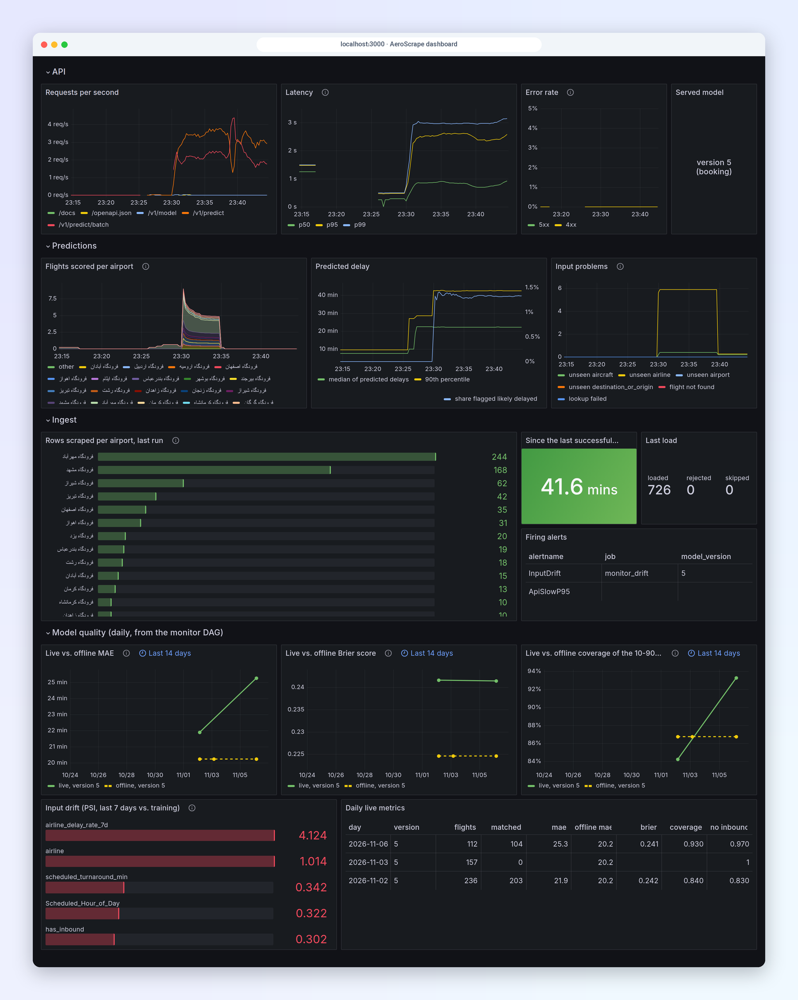
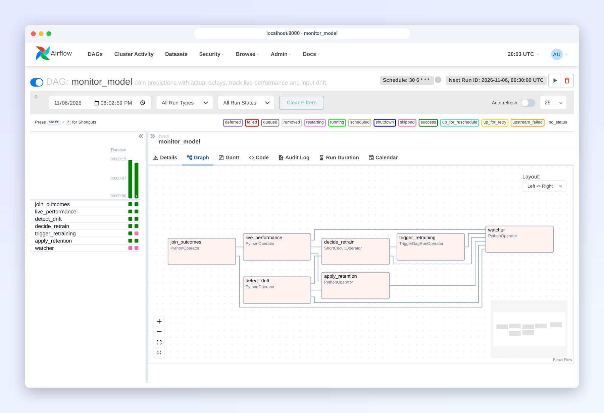
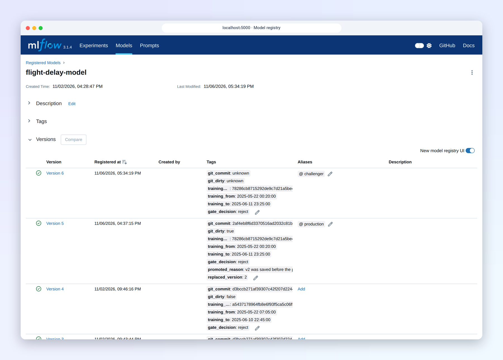
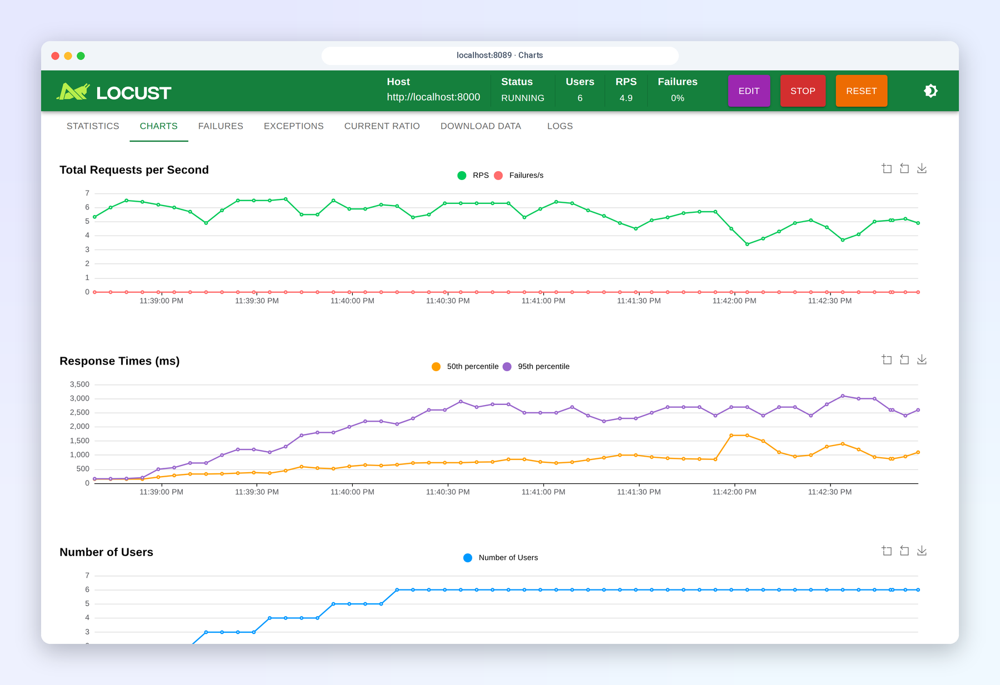
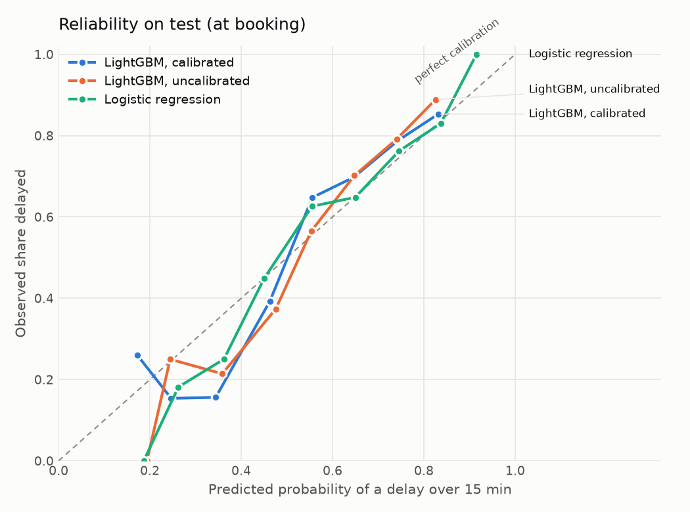
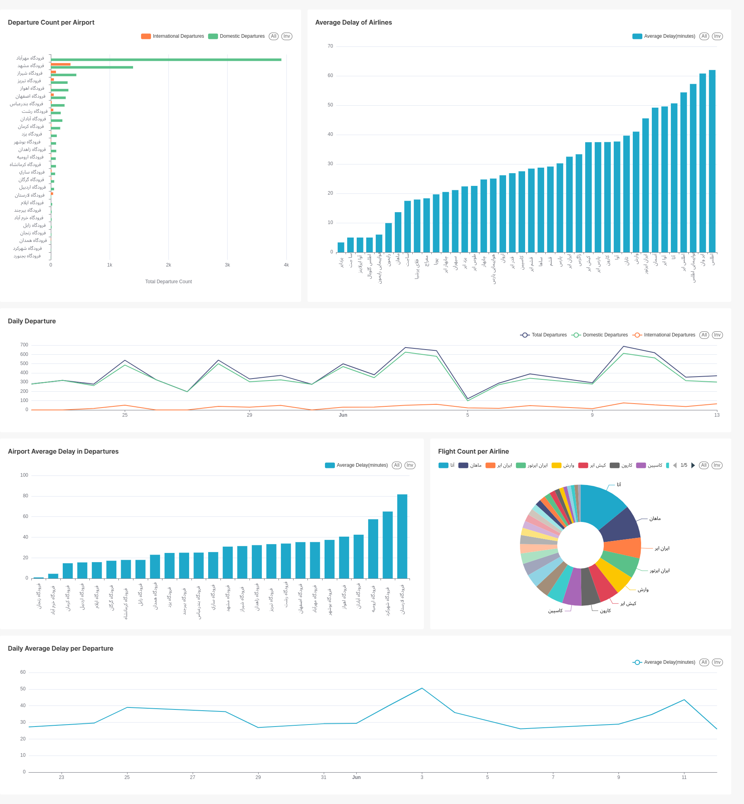
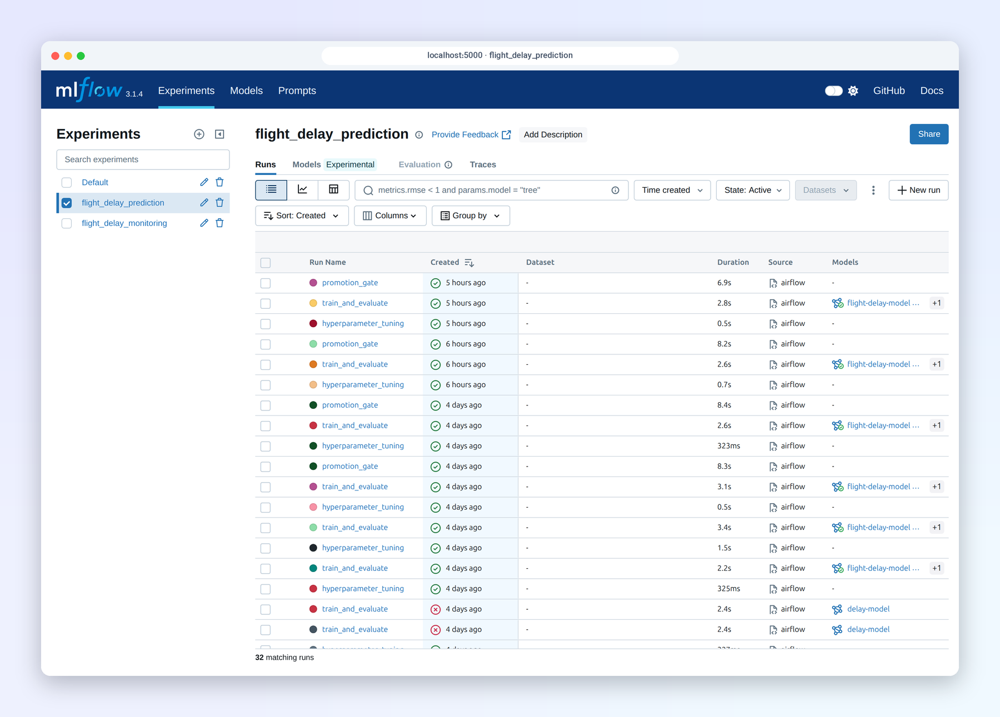

# AeroScrape: End-to-End Flight Delay Prediction MLOps Pipeline

[](https://github.com/AminRezaeeyan/AeroScrape/actions/workflows/ci.yml)

AeroScrape is a comprehensive MLOps (Machine Learning Operations) project designed to scrape real-time flight data, store it, train machine learning models to predict flight delays, and serve these predictions via a RESTful API. The entire pipeline is orchestrated using Apache Airflow, tracks experiment iterations via MLflow, and provides real-time explanations for predictions using SHAP (Explainable AI), served on a clean Streamlit interface.


<table>
<tr>
<td width="50%"><a href="docs/screenshots/grafana-dashboard.png"></a><br><sub><b>Grafana</b>: API traffic, scraper rows, live vs. offline accuracy and input drift</sub></td>
<td width="50%"><a href="docs/screenshots/airflow-monitor-dag.png"></a><br><sub><b>Airflow</b>: the daily monitoring DAG, which can trigger retraining</sub></td>
</tr>
<tr>
<td><a href="docs/screenshots/mlflow-registry.png"></a><br><sub><b>MLflow</b>: versions with lineage tags, gate decisions and aliases</sub></td>
<td><a href="docs/screenshots/locust-charts.png"></a><br><sub><b>Locust</b>: load test of the prediction API</sub></td>
</tr>
</table>


## Results

For each departure the model returns a **calibrated probability of a delay over 15 minutes** and a **likely delay range** (10th to 90th percentile, which contains about 8 in 10 flights). Two variants: one usable when the flight is booked, one an hour before departure, when the aircraft's previous delay is known.

Evaluated on a chronological split: model choices from rolling-origin CV on 2025-05-22 to 06-09, tested once on 06-10 to 06-12 (687 domestic departures, 26 airports). Changes are paired 95% bootstrap intervals against the best baseline (airline delay rate; airline × time-of-day median or percentiles). Full report in [docs/results/evaluation.md](docs/results/evaluation.md), regenerated with `make evaluate`.

| Model | MAE (min) | Change vs baseline | Range coverage (target 80%) | Brier | Change vs baseline |
| --- | --- | --- | --- | --- | --- |
| Best baseline | 24.7 | | 76.4% | 0.221 | |
| At booking | 24.0 | -0.7 [-1.2, -0.3] | 82.7% | 0.207 | -0.014 [-0.023, -0.005] |
| 1 h before departure | 23.0 | -1.7 [-2.6, -0.9] | 85.3% | 0.201 | -0.020 [-0.030, -0.011] |

Both variants beat the baselines on every metric, by modest margins. Most of the gain comes from recovering data the original cleaner discarded (training rows grew from 2,313 to 3,574) and from delay propagation: when the same aircraft's previous delay is known, the 1-hour model's error drops from 25.0 to 18.9 minutes. Aircraft registrations are only published at Mehrabad, so that applies to about a third of flights. The "likely delayed" flag is set for 75% precision and reaches 80-85% on test.



### The same pipeline on US data

`SOURCE=bts` runs every step unchanged on the Bureau of Transportation Statistics on-time data for Atlanta (January to May 2026, 118,690 training departures, tested on 6,241), which records the tail number of nearly every flight:

| Dataset | Model | MAE vs best baseline | Brier | PR-AUC |
| --- | --- | --- | --- | --- |
| Iran, 3 weeks | 1 h before departure | -1.7 min [-2.6, -0.9] | 0.201 | 0.803 |
| US BTS, 5 months | 1 h before departure | -5.1 min [-5.5, -4.7] | 0.123 | 0.739 |
| US BTS, 5 months | at booking | -1.0 min [-1.2, -0.9] | 0.171 | 0.501 |

PR-AUC and Brier depend on how common delays are (60% of Iranian test flights, 26% of BTS ones), so compare each dataset with its own baselines rather than with the other. Delay propagation alone cuts BTS error by 4.8 minutes, and a learning curve shows error levelling off after about 12,000 training departures, roughly seven weeks of Iranian scraping. For the Iranian model, though, registration coverage (a third of departures, against 85% in BTS) limits it more than volume. BTS is US data, so these numbers show what the pipeline can do with enough data, not what the Iranian model will reach. Details: [docs/bts.md](docs/bts.md).

How the outputs are produced, calibrated and checked, including error analysis by segment: [docs/modeling.md](docs/modeling.md). Features and the ablation: [docs/features.md](docs/features.md). The first version of this project reported better-looking numbers from a random split and tuned on the test set; with an honest evaluation and the original features, it did not beat these baselines.

## Table of Contents

-   [Results](#results)
-   [Features](#features)
-   [Architecture Overview](#architecture-overview)
-   [Getting Started (Docker Compose - Recommended)](#getting-started-docker-compose---recommended)
-   [Getting Started (Local Manual Setup)](#getting-started-local-manual-setup)
-   [Inference & Explainability Interface](#inference--explainability-interface)
-   [Usage Workflow](#usage-workflow)
-   [Data Analysis with Apache Superset](#data-analysis-with-apache-superset)
-   [MLflow Integration](#mlflow-integration)
-   [CLI Tool (`aeroscrape`)](#cli-tool-aeroscrape)
-   [FastAPI Endpoints](#fastapi-endpoints)
-   [Contributors](#contributors)
-   [Acknowledgements](#acknowledgements)
-   [License](#license)

## Features

* **Flight Data Scraping:** Real-time collection of flight arrival and departure data from `fids.airport.ir`.
* **Data Storage:** Persistent storage of scraped and processed flight data in a PostgreSQL database.
* **Automated ML Pipeline (Airflow):**
    * Raw data validation using `pandera`.
    * Data cleaning and feature engineering (e.g., time-of-day, season, holiday indicators).
    * Data preprocessing (splitting, scaling, one-hot encoding).
    * Hyperparameter tuning for regression (LightGBM) and classification (Logistic Regression) models using Optuna.
    * Model training and evaluation.
    * Cleanup of intermediate data.
* **MLflow Integration:**
    * **Experiment Tracking:** Logs all model training parameters, metrics, and artifacts.
    * **Model Registry:** Centralized management and versioning of trained models, with automated alias assignment (e.g., to "production").
* **Explainable AI (SHAP):** Integrates individual feature contributions for every single prediction, identifying factors that decrease or increase flight delays.
* **Inference Dashboard (Streamlit):** An interactive demo to query predictions and visualize SHAP force contributions on a clean web UI.
* **Monitoring:** every prediction is logged and matched to the actual delay; live MAE, Brier and coverage are compared with the offline numbers, inputs are checked for drift, and an alert triggers retraining through the promotion gate. Prometheus, Pushgateway and Grafana run in the same Compose stack ([docs/monitoring.md](docs/monitoring.md)).

## Architecture Overview

The AeroScrape project is built with a modular architecture, separating concerns into distinct services and components:

1.  **Data Ingestion (Scraper):** A Python script (`aeroscrape.scraping.scraper`) that fetches flight data from `fids.airport.ir`. The `aeroscrape` command (`aeroscrape.cli`) orchestrates data scraping, CSV import, and database export.
2.  **Database:** A PostgreSQL database (`db` service in Docker setup) for storing raw and processed flight information.
3.  **ML Pipeline:** The `aeroscrape.data`, `aeroscrape.features`, `aeroscrape.models` and `aeroscrape.pipeline` packages that perform the core ML workflow steps, from data validation to model training.
4.  **Orchestration (Apache Airflow):** Airflow DAGs (`dags/`) define and schedule the execution of the ML pipeline scripts as a Directed Acyclic Graph.
5.  **MLflow Tracking Server:** An MLflow instance (the `mlflow` service in Docker) that serves as a centralized repository for logging ML experiments, tracking metrics, and managing model versions in the Model Registry.
6.  **Inference API (FastAPI):** A FastAPI application (`aeroscrape.serving.api`) that loads the native ML model from MLflow Model Registry and provides a RESTful endpoint returning predictions along with real-time SHAP values.
7.  **Inference Dashboard (Streamlit):** A user-friendly web interface (`aeroscrape.demo.streamlit_app`) allowing users to input flight details and examine predicted delays alongside contribution charts.
8.  **Monitoring (`aeroscrape.monitoring`):** the API's prediction log, the daily `monitor_model` DAG (outcomes, live performance, drift, retraining), and Prometheus, Pushgateway and Grafana with alert rules and a dashboard committed under `monitoring/`.
9.  **Configuration (`aeroscrape.config`):** A configuration loader that handles both environment variables (`.env`) and structured YAML configuration (`config.yaml`).

---

## Getting Started (Docker Compose - Recommended)

This is the easiest way to launch the entire MLOps environment. All components (Database, MLflow, Airflow Webserver, Airflow Scheduler, FastAPI, Streamlit, Scraper) are configured with aligned volumes to share models, metadata, and artifacts.

### Prerequisites
* **Docker** and **Docker Compose** installed on your host system.

### Steps to Run

1. **Clone the Repository:**
   ```bash
   git clone https://github.com/aminrezaeeyan/AeroScrape.git
   cd AeroScrape
   ```

2. **Configure Environment Variables:**
   ```bash
   cp template.env .env
   ```
   Edit `.env` and set every password and `AEROSCRAPE_API_KEY` (the API's key; the demo sends it too). `DB_ADMIN_*` is the Postgres superuser that only sets up the database; the scraper uses the limited `DB_USER` role and Airflow uses `AIRFLOW_DB_USER`. If a value contains `$`, write it as `$$`, because Docker Compose expands variables in this file.

3. **Download the Dataset and Launch the Stack:**
   ```bash
   make data   # downloads data/raw/data.csv and verifies its checksum
   make up
   ```
   This builds the image, creates the flight and Airflow databases, and starts all services. Postgres only runs its init scripts on an empty volume, so changing these roles later needs `docker compose down -v`, which deletes the stored flight data.

4. **Collect data and train:**
   * Open Airflow at **`http://localhost:8080`** and log in with `AIRFLOW_ADMIN_USER` and `AIRFLOW_ADMIN_PASSWORD` from `.env`.
   * `make ingest` scrapes the flight boards now and unpauses the 3-hourly `ingest_flights` DAG.
   * `make train` runs `train_delay_model`: it trains a challenger and promotes it only if it passes the gate. The first model is promoted if it beats the baseline.

5. **Serve the model:** the API picks up a newly promoted model within 2 minutes, or immediately with `curl -X POST -H "X-API-Key: $AEROSCRAPE_API_KEY" http://localhost:8000/v1/reload`. `make model-status` shows what is serving and `make rollback VERSION=n` goes back to an earlier version. See [docs/operations.md](docs/operations.md).

6. **Access the Services:**
   * **Inference Web UI (Streamlit):** `http://localhost:8501`
   * **Inference REST API (FastAPI):** `http://localhost:8000` (API Docs at `/docs`)
   * **Orchestrator (Apache Airflow):** `http://localhost:8080`
   * **Experiment Tracking (MLflow Server):** `http://localhost:5000`
   * **Monitoring (Grafana):** `http://localhost:3000`, user `admin` and `GRAFANA_ADMIN_PASSWORD`; Prometheus at `http://localhost:9090`

   A database created before monitoring existed needs `make migrate` once, for the monitoring tables and roles.

---

## Getting Started (Local Manual Setup)

If you prefer to configure and run the services natively on your local machine instead of Docker, follow the manual steps below.

### Prerequisites

* **Git:** For cloning the repository.
* **Python 3.12** and **[uv](https://docs.astral.sh/uv/)**: `uv` installs the locked dependencies.
* **PostgreSQL:** Your application's scraper and database module (`aeroscrape.storage.database`) are designed to connect to a PostgreSQL database. You'll need a local PostgreSQL server running.
    ```bash
    sudo apt install postgresql postgresql-contrib
    sudo systemctl start postgresql
    sudo systemctl enable postgresql
    ```

### Cloning the Repository

```bash
git clone https://github.com/aminrezaeeyan/AeroScrape.git
cd AeroScrape
```

### Environment Setup

```bash
make setup               # installs uv.lock into .venv and the pre-commit hooks
source .venv/bin/activate
make data                # downloads the raw dataset
```

`make lint` and `make test` run the checks. All targets are listed in the [Makefile](Makefile).

### Configuration

1.  **Create `.env` file:**
    ```bash
    cp template.env .env
    ```
    Edit `.env` and set a strong password for your local PostgreSQL database. Also run `export MLFLOW_TRACKING_URI=http://127.0.0.1:5000`, because `config.yaml` points at the Docker hostname.

2.  **`config.yaml`:**
    Ensure this file exists in your project root with your pipeline parameters.

### Database Initialization

1.  **Connect to local PostgreSQL:**
    ```bash
    sudo -u postgres psql
    ```
2.  **Create Database and User:**
    ```sql
    CREATE DATABASE "flight-data";
    CREATE USER "flight-database-user" WITH ENCRYPTED PASSWORD 'your_secure_password_here'; -- Matches your .env
    GRANT ALL PRIVILEGES ON DATABASE "flight-data" TO "flight-database-user";
    \q
    ```
3.  **Initialize Database Schema:**
    ```bash
    psql -U flight-database-user -d flight-data -f init/10_init_db.sql
    ```

### Running MLflow Tracking Server

1.  **Open a new terminal window, navigate to project root, and run `source .venv/bin/activate`.**
2.  **Start MLflow Server:**
    ```bash
    mkdir -p mlruns 
    mlflow server --host 0.0.0.0 --port 5000 --backend-store-uri sqlite:///mlruns/mlruns.db --default-artifact-root ./mlruns
    ```
    *Access the MLflow UI at: `http://127.0.0.1:5000`*

### Running Apache Airflow

1.  **Setup Environment variables and folders:**
    ```bash
    export AIRFLOW_HOME=~/airflow
    mkdir -p "$AIRFLOW_HOME"
    rm -rf "$AIRFLOW_HOME/dags"
    ln -s "$(pwd)/dags" "$AIRFLOW_HOME/dags"
    export AEROSCRAPE_HOME="$(pwd)"
    ```
2.  **Initialize Metadata Database:**
    ```bash
    airflow db migrate
    ```
3.  **Create Admin User:**
    ```bash
    airflow users create \
        --username admin \
        --firstname Admin \
        --lastname User \
        --role Admin \
        --email admin@example.com
    ```
4.  **Configure Airflow to load `.env`:**
    Add your path inside `[core]` under `$AIRFLOW_HOME/airflow.cfg`:
    ```ini
    [core]
    env_file = /home/amin/AeroScrape/.env
    ```
5.  **Start Webserver and Scheduler (Keep terminals running):**
    ```bash
    airflow webserver -p 8080
    # In another terminal:
    airflow scheduler
    ```

### Running FastAPI Inference Service

```bash
uvicorn aeroscrape.serving.api:app --host 0.0.0.0 --port 8000 --reload
```
*Access docs at: `http://127.0.0.1:8000/docs`*

### Running Streamlit Frontend Dashboard

```bash
streamlit run src/aeroscrape/demo/streamlit_app.py --server.port 8501 --server.address 0.0.0.0
```
*Access dashboard at: `http://localhost:8501`*

---

## Inference & Explainability Interface

The demo dashboard provides a comprehensive evaluation of flight delay predictions. Beyond returning a numeric estimate, the backend computes individual feature importance using **SHAP**. This exposes exactly what factors are contributing to or preventing delays.

The dropdowns offer the airlines, airports, destinations and aircraft the served model was trained on (`GET /v1/model`). The result shows the calibrated chance of a delay over 15 minutes, the likely delay with its 10–90% range against the 15-minute line, and the SHAP contributions of the flight's features. The demo uses the [Vazirmatn](https://github.com/rastikerdar/vazirmatn) font, bundled with the app.


---

## Testing

`make test` runs the suite (about 170 tests, under a minute); CI runs it on every push and pull request together with ruff, mypy and a Docker build ([`.github/workflows/ci.yml`](.github/workflows/ci.yml)). The tests target what breaks silently rather than a coverage number:

| What | Where |
| --- | --- |
| Scraper parsing on real FIDS pages (an airport with international flights and a domestic-only one) | `tests/test_scraper.py` |
| Cleaning, status parsing, date handling and the raw data contract | `tests/test_clean.py`, `tests/test_data_pipeline.py` |
| Each feature's value, and that rates never see the flight's own day or later (leakage) | `tests/test_features.py` |
| Train/serve parity: 50 flights get identical features through the training and API paths | `tests/test_parity.py` |
| End-to-end training on a 200-row fixture, tuning never reading the test split | `tests/test_experiment.py` |
| The served MLflow model, its signature, calibration, threshold and intervals | `tests/test_delay_model.py` |
| The promotion gate's decisions and registry rollback | `tests/test_gate.py`, `tests/test_registry.py` |
| API responses, errors, the feature lookup and hot swap | `tests/test_api.py` |
| Database upserts and reads against a real Postgres (CI service; locally with `AEROSCRAPE_TEST_DB=1`) | `tests/test_database_load.py` |
| Prediction log, outcome matching, live metrics, drift (PSI) and the retraining decision; the tables and the API role's rights in Postgres | `tests/test_monitoring.py`, `tests/test_monitoring_db.py` |
| Alert rules, with `promtool` (`make check-monitoring`) | `monitoring/alerts.test.yml` |
| DAG imports and structure | `tests/test_dags.py` |
| The BTS adapter, on synthetic data in the exact BTS file layout | `tests/test_bts.py` |

The Airflow task wrappers are covered by running the DAGs in Docker rather than by unit tests.

## Usage Workflow

1.  **Data ingestion:** the `ingest_flights` DAG scrapes every 3 hours (`make ingest` runs it now). `aeroscrape` runs one scrape from the command line.
2.  **Training:** `train_delay_model` runs weekly (`make train` runs it now) and ends with the promotion gate.
3.  **Model management:** `make model-status`, `make rollback VERSION=n`; every gate decision is an MLflow `promotion_gate` run.
4.  **Prediction:** `POST http://localhost:8000/v1/predict` (or `/v1/predict/batch`) with the `X-API-Key` header, or the Streamlit demo at `http://localhost:8501`.
5.  **Monitoring:** `monitor_model` runs daily (`make monitor` runs it now); `make replay DAYS=7` sends last week's scraped flights through the API as live traffic. See [docs/monitoring.md](docs/monitoring.md).

---

## Data Analysis with Apache Superset


_A sample dashboard in Apache Superset for data analysis._

Apache Superset is an open-source data visualization and data exploration platform. In this project, we have utilized Superset for analyzing the scraped and processed flight data. It provides intuitive dashboards that allow for deep insights into the dataset, helping to understand flight patterns, delays, and other key metrics.

---

## MLflow Integration


_The registry: each version carries its git commit, training window and data hash, and the gate's decision; the aliases mark what serves._


_Every training run, tuning run and gate decision of the pipeline._

MLflow is deeply integrated into the pipeline to ensure robust MLOps practices:

* **Experiment Tracking:** Every run of the `task_tune_hyperparameters`, `task_train_evaluate_regression`, and `task_train_evaluate_classification` tasks in Airflow logs its parameters, metrics, and artifacts (like the `config.yaml`, preprocessor, and best parameters JSON) to the MLflow Tracking Server.
* **Model Registry:** each training run registers one model, `flight-delay-model`, as the `challenger`; only the promotion gate moves the `production` alias to it ([docs/operations.md](docs/operations.md)).

---

## CLI Tool (`aeroscrape`)

The `aeroscrape` command provides a command-line interface for direct interaction with the project's data scraping and database operations.

```bash
aeroscrape --help
```

**Examples:**

* **Scrape and Import Flight Data (Default):**
    ```bash
    aeroscrape --date 2026-06-03
    ```
* **Import Flight Data from CSV:**
    ```bash
    aeroscrape --csv data/raw/flights_to_import.csv --date 2026-06-03
    ```
* **Export Flight Data to CSV:**
    ```bash
    aeroscrape --export-csv-path data/exported_flights.csv
    ```

---

## FastAPI Endpoints

The FastAPI service provides a RESTful API for real-time flight delay predictions.

* **API Documentation:** `http://localhost:8000/docs` (Swagger UI)
* **Liveness and readiness:** `GET /health`, `GET /ready`
* **Prometheus metrics:** `GET /metrics`
* **Contract, security, logs and measured latency:** [docs/serving.md](docs/serving.md)

### `POST /v1/predict`

Returns a calibrated probability of a delay over 15 minutes and a likely delay range; add `?explain=true` for the main factors. Features are built from the flight database with the same code as training. `flight_number` and `register` are optional, but with them the aircraft's rotation is used. Requests need the `X-API-Key` header (the key is `AEROSCRAPE_API_KEY` in `.env`).

```bash
curl -X POST "http://localhost:8000/v1/predict?explain=true" \
  -H "X-API-Key: $AEROSCRAPE_API_KEY" -H 'Content-Type: application/json' \
  -d '{
    "airline": "وارش",
    "airport": "فرودگاه مهرآباد",
    "destination_or_origin": "مشهد",
    "aircraft": "737",
    "scheduled_datetime": "2026-11-03 08:05:00",
    "flight_number": "VRH5840"
  }'
```

```json
{
  "p_delay_over_15": 0.664,
  "likely_delayed": false,
  "delay_minutes": {"p10": 4.7, "p50": 20.1, "p90": 107.9},
  "top_factors": [
    {"feature": "nth_flight_of_day_for_aircraft", "value": "1", "contribution": 0.163},
    {"feature": "destination_or_origin", "value": "مشهد", "contribution": 0.136}
  ],
  "warnings": ["Not known for this flight, filled by the model: scheduled_turnaround_min"],
  "model_version": "5",
  "decision_threshold": 0.69,
  "explanation_units": "log-odds of a delay over 15 minutes, from the uncalibrated LightGBM classifier"
}
```

`POST /v1/predict/batch` takes `{"flights": [...]}` with up to 500 flights and returns `predictions` in the same order. On a laptop a single prediction takes about 100 ms and a batch of 50 about 140 ms.

## Contributors

* **Mahan Zavari** (mahanzavari@gmail.com)
* **Amin Rezaeeyan** (rezaeeyanamin@gmail.com)

## Acknowledgements

This project was developed under the esteemed supervision of **Dr. Hamidreza Shahriari** in the **Amirkabir University Of Technology (AUT-CE)**.

## License

This project is licensed under the MIT License - see the [LICENSE](LICENSE) file for details.
