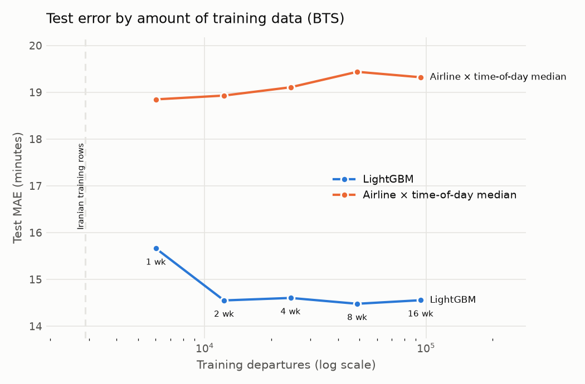

# Running the pipeline on US BTS data

Three weeks of Iranian data can't show how the pipeline behaves at scale. The US Bureau of Transportation Statistics publishes every US domestic flight, by month, with the aircraft's tail number, so the same delay-propagation features apply. Running the identical pipeline on it shows that the pipeline is source-agnostic and how results change with data volume.

## How BTS maps to the pipeline

[`scraping/bts.py`](../src/aeroscrape/scraping/bts.py) downloads the monthly "Reporting Carrier On-Time Performance" zips from TranStats and translates them into the cleaned flight schema. Everything after that, from features and splits to the models, the gate and the report, is unchanged.

| Cleaned column | BTS column |
| --- | --- |
| `scheduled_datetime` (departure) | `FlightDate` + `CRSDepTime` (2400 is midnight) |
| `actual_datetime` (departure) | scheduled + `DepDelay` |
| `scheduled_datetime` (arrival) | `FlightDate` + `CRSArrTime`, next day if it is over 2 hours before the departure clock time |
| `airline`, `flight_number` | `Reporting_Airline`, airline + `Flight_Number_Reporting_Airline` |
| `airport`, `destination_or_origin` | `Origin` / `Dest` |
| `register` | `Tail_Number` (invalid values dropped) |
| `status` | `Cancelled` → cancelled, `Diverted` → unknown, otherwise departed or landed |

Each BTS flight becomes a departure row at its origin and an arrival row at its destination, the way the Iranian boards list a flight once at each end. BTS has no aircraft type, so that feature is empty.

## Configuration

`config.yaml` has a `profiles.bts` section that overrides the defaults when `SOURCE=bts`:

- **Data:** January to May 2026 for flights touching **Atlanta (ATL)**. Only ATL departures are predicted; flights at other airports are context for rotation features.
- **Held-out window:** 7 test dates and 7 validation dates, against 3 and 2 for the Iranian data.
- **Lighter tuning,** since the data is about 50 times larger.
- **A separate registry name,** `flight-delay-model-bts`, so the gate never compares a US model with an Iranian one.

## Running it

BTS blocks some networks and VPN exits (a TCP timeout to `transtats.bts.gov`, or 403 from `bts.gov`). With access:

```bash
make bts-data                  # download Jan-May 2026 into data/bts/ (~5 x 25 MB)
make evaluate SOURCE=bts       # tune, train, calibrate, evaluate; writes reports/bts/
make learning-curve            # test MAE for 1, 2, 4, 8 and 16 weeks of training data
make train SOURCE=bts          # the same through Airflow, with the gate and the BTS registry
```

`make evaluate SOURCE=bts` takes on the order of 30-60 minutes on a laptop, most of it tuning. If the download fails, save these files in a browser into `data/bts/` under the names shown, and the commands above will use them:

| Month | URL | Save as |
| --- | --- | --- |
| 2026-01 | https://transtats.bts.gov/PREZIP/On_Time_Reporting_Carrier_On_Time_Performance_1987_present_2026_1.zip | `data/bts/bts_2026_01.zip` |
| 2026-02 | https://transtats.bts.gov/PREZIP/On_Time_Reporting_Carrier_On_Time_Performance_1987_present_2026_2.zip | `data/bts/bts_2026_02.zip` |
| 2026-03 | https://transtats.bts.gov/PREZIP/On_Time_Reporting_Carrier_On_Time_Performance_1987_present_2026_3.zip | `data/bts/bts_2026_03.zip` |
| 2026-04 | https://transtats.bts.gov/PREZIP/On_Time_Reporting_Carrier_On_Time_Performance_1987_present_2026_4.zip | `data/bts/bts_2026_04.zip` |
| 2026-05 | https://transtats.bts.gov/PREZIP/On_Time_Reporting_Carrier_On_Time_Performance_1987_present_2026_5.zip | `data/bts/bts_2026_05.zip` |

## The learning curve

[`models/learning_curve.py`](../src/aeroscrape/models/learning_curve.py) trains on the last 1, 2, 4, 8 and 16 weeks before the same test week, with default parameters, and plots test MAE for the model and the airline × time-of-day baseline against the number of training departures. A dashed line marks the size of the Iranian training set (2,887 departures), so the curve answers "how much Iranian data would the model need?" with evidence.

## Results

Atlanta departures, January to May 2026: 118,690 training departures, tested once on the last week of May (6,241 departures). Full report: [results/bts/evaluation.md](results/bts/evaluation.md). Changes are paired 95% bootstrap intervals against the best baseline.

| Model | MAE (min) | Change vs baseline | Range coverage (target 80%) | Brier | PR-AUC |
| --- | --- | --- | --- | --- | --- |
| Best baseline | 19.4 | | 81.9% | 0.194 | 0.296 |
| At booking | 18.4 | -1.0 [-1.2, -0.9] | 79.0% | 0.171 | 0.501 |
| 1 h before departure | 14.3 | -5.1 [-5.5, -4.7] | 80.6% | 0.123 | 0.739 |

### What carries the gain

The feature ablation, each row adding one group (paired change in MAE against the first row):

| Features | MAE (min) | Change | PR-AUC |
| --- | --- | --- | --- |
| calendar + identity | 19.3 | reference | 0.403 |
| + rotation | 18.7 | -0.6 [-0.7, -0.5] | 0.407 |
| + congestion | 19.1 | -0.2 [-0.5, +0.1] | 0.406 |
| + rates | 18.6 | -0.7 [-0.9, -0.4] | 0.424 |
| + live propagation | 14.5 | -4.8 [-5.3, -4.4] | 0.662 |

Delay propagation is most of the model: knowing how late the same aircraft's previous flight was cuts error by almost 5 minutes, and departures whose aircraft history is unknown have twice the error (MAE 25.3 against 12.4 one hour before departure). That is the hypothesis this project was built on, confirmed on 40 times more data than the Iranian set. With enough data the schedule features (rotation, 7-day rates) also add a measurable amount, which they did not on three weeks of Iranian data.

### How much data is needed



| Weeks of training | Departures | LightGBM MAE | Change vs baseline |
| --- | --- | --- | --- |
| 1 | 6,021 | 15.66 | -3.19 [-3.57, -2.86] |
| 2 | 12,230 | 14.55 | -4.38 [-4.84, -3.99] |
| 4 | 24,432 | 14.60 | -4.50 [-4.92, -4.13] |
| 8 | 48,870 | 14.48 | -4.96 [-5.41, -4.56] |
| 16 | 94,544 | 14.56 | -4.77 [-5.21, -4.36] |

Error stops improving after about two weeks, around 12,000 departures. Two consequences for the Iranian model:

- **Volume:** its 2,887 training departures sit below the smallest point on this curve. The 2025 scrapes yield about 240 usable departures per scraped day across 26 airports, so with the ingest DAG running every day (about 1,700 a week) it would take roughly seven weeks to reach 12,000.
- **Coverage matters more than volume:** in BTS 85% of departures have the aircraft's previous delay; in the Iranian data about a third do, because registrations are only published at Mehrabad. More weeks of scraping will not raise that share, so the Iranian model will stay closer to the "at booking" result than to the "1 hour before" one unless more airports publish registrations.

### Calibration and drift

The test week starts on Memorial Day (25 May), when 39% of departures were delayed, and the week as a whole had 26% delayed against 19% in training. Every model's probabilities come out somewhat low on test (reliability chart in the report; expected calibration error 0.028 to 0.049), the same kind of shift the Iranian validation window showed. It is the case for monitoring live calibration (Phase 9) and for the holiday features that are disabled until the Iranian data spans a year.

The 75% precision target for the "likely delayed" flag is too strict for the booking-time model on BTS: with only a quarter of flights delayed, reaching it flags just 1% of flights. The target is a product decision that should be set per market.

## Limits

BTS is US data: US hubs, carriers, weather and air-traffic control behave differently from Iranian airports, so its numbers show what the pipeline can do with enough data, not what the Iranian model will reach. Delays beyond 12 hours are treated as data errors in both sources (a small share of BTS flights).
