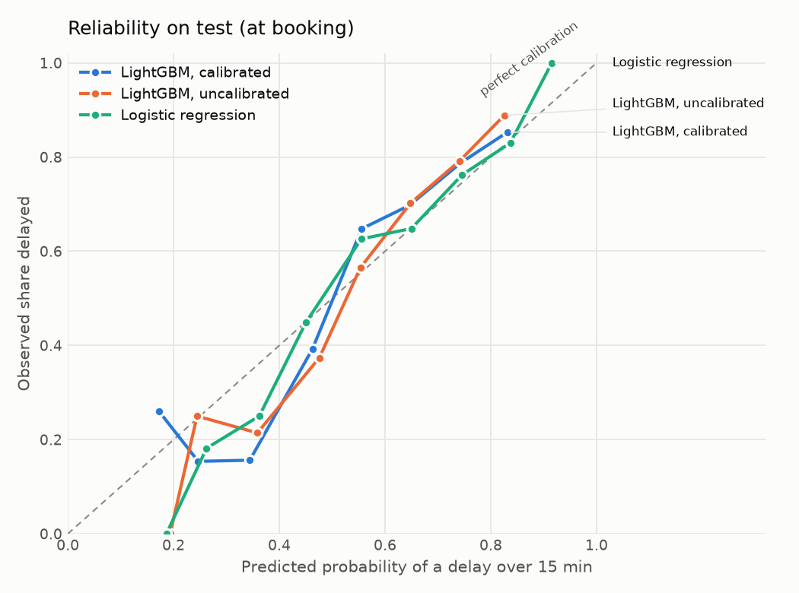
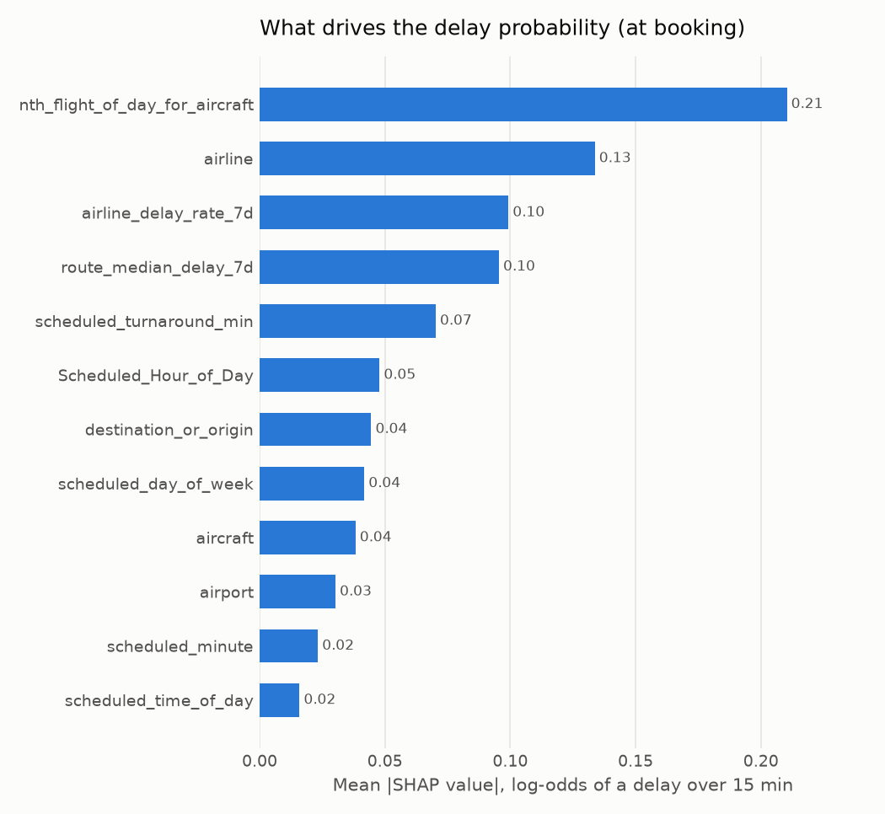

# Modeling: probabilities and delay ranges

A single number like "35 minutes late" claims a precision the model doesn't have. The served model returns what it can honestly say, for one departure:

| Output | Example | Meaning |
| --- | --- | --- |
| `p_delay_over_15` | 0.62 | Calibrated probability of a delay over 15 minutes |
| `likely_delayed` | true | `p_delay_over_15` reached the decision threshold (about 3 in 4 flagged flights are delayed) |
| `delay_minutes` | p10 8, p50 22, p90 64 | About 8 in 10 flights fall between p10 and p90; p50 is the median |
| `top_factors` | airline +0.40 | Per-flight SHAP contributions, in log-odds of a delay over 15 minutes |

Everything comes from one MLflow model, `flight-delay-model` ([`models/delay_model.py`](../src/aeroscrape/models/delay_model.py)). It bundles three quantile regressors, a LightGBM classifier, its calibrator, the conformal margin and the threshold, and is logged with an input signature, so MLflow rejects malformed input.

## How each piece is fit

Train and validation are pooled (2025-05-22 to 06-09, 2,887 departures) and split again by rolling-origin CV into 4 folds, each trained on earlier flights and predicting later ones. The out-of-fold predictions, covering about twelve days, are used for every choice below. The final models are refit on all of train+val, and test (06-10 to 06-12, 687 departures) is scored once.

| Piece | Choice | Fit on |
| --- | --- | --- |
| Hyperparameters | Optuna, CV MAE (regression) or CV Brier (classifiers) | rolling-origin CV |
| Delay range | LightGBM with `objective="quantile"` at 0.1, 0.5 and 0.9; crossing quantiles sorted per flight | train+val |
| Range width | Conformalized quantile regression: widen by the margin that makes 80% of out-of-fold flights fall inside | out-of-fold |
| Target transform | `none`, `log` or clip at 300 min; a transform must beat `none` by 1% out-of-fold MAE | out-of-fold |
| Probability | LightGBM classifier with a tuned positive-class weight, then Platt (sigmoid) scaling | train+val; calibrator out-of-fold |
| Decision threshold | Lowest calibrated probability with precision of at least 75% | out-of-fold |

**Why not calibrate on the validation split?** That was the first version. The validation window was two days with 52% of flights delayed, against 60% in train and test, so the calibrated probabilities came out too low on test (ECE 0.073 to 0.086). Daily delay rates in this data range from 48% to 66%, so a two-day window is not a representative sample of days. Out-of-fold predictions span about twelve days.

## Results on test

Full numbers in [results/evaluation.md](results/evaluation.md). Differences are paired bootstrap intervals against the best baseline.

| Model | Change in MAE | Change in pinball loss | Change in Brier | Change in PR-AUC |
| --- | --- | --- | --- | --- |
| At booking | -0.7 min [-1.2, -0.3] | -0.39 [-0.67, -0.15] | -0.014 [-0.023, -0.005] | +0.048 [0.009, 0.093] |
| 1 h before departure | -1.7 min [-2.6, -0.9] | -0.70 [-1.02, -0.40] | -0.020 [-0.030, -0.011] | +0.086 [0.051, 0.124] |

- **Range coverage:** the raw quantile models cover 72-77% of test flights; with the conformal margin, 83-85% against an 80% target. The ranges are wide (72 to 75 minutes on average): with the information available, a delay can't be pinned down more tightly.
- **Threshold:** chosen for 75% out-of-fold precision; on test it reaches 80% (at booking) and 85% (1 h before) precision, flagging a quarter of flights and catching about a third of the delayed ones. A higher-recall setting is a config change (`precision_target`).
- **Calibration:** see the chart below. LightGBM's raw probabilities were already close to calibrated, and on this test set Platt scaling changes Brier and ECE by less than their intervals. It is kept because it is cheap and protects against a tuned class weight distorting probabilities; logistic regression is the best-calibrated model here (ECE 0.029).

## Error analysis

Test MAE by segment ([results/evaluation.md](results/evaluation.md#error-analysis) has coverage and Brier too). Segments are small, so differences of a few minutes are within noise.

| Segment | Flights | Delayed | MAE at booking | MAE 1 h before |
| --- | --- | --- | --- | --- |
| Mehrabad | 413 | 68% | 24.7 | 23.2 |
| Other airports | 245 | 47% | 23.3 | 23.2 |
| Inbound flight linked | 275 | 65% | 21.3 | 19.2 |
| No inbound flight linked | 412 | 57% | 25.8 | 25.6 |
| Aircraft's previous delay known | 224 | 66% | 21.9 | 18.9 |
| Previous delay unknown | 463 | 57% | 25.0 | 25.0 |
| Airline آتا | 104 | 79% | 31.3 | 28.3 |
| Airline ماهان | 69 | 33% | 11.0 | 11.4 |

The model is best where it knows the aircraft's rotation: when the previous delay of the same aircraft is known, the 1-hour-before model's MAE drops from 25.0 to 18.9 minutes. Without it, both variants perform the same. Errors are largest for the airlines with the most delays (آتا, ایران ایرتور), where long delays dominate MAE.

## What drives the probability

Mean absolute SHAP value of the LightGBM classifier on test, in log-odds. Two cautions:

- `nth_flight_of_day_for_aircraft` ranks first partly because it is missing for flights without a registration, which is almost every flight outside Mehrabad; its missing-value indicator acts as an "is this Mehrabad?" flag.
- SHAP measures how much the model uses a feature, not how much it improves predictions. The ablation in [features.md](features.md) is the measure of value.

Explanations use the uncalibrated classifier. Calibration is a monotone map applied afterwards, so it changes how big the probability is but not which features push it up or down.

## Known limits

- Test covers three days in June 2025, and delay rates move by several points from day to day. Live calibration and coverage are tracked per day by the monitor DAG ([monitoring.md](monitoring.md)).
- The served variant is "at booking": most requests carry no registration, so the aircraft's live delays are unknown. The API builds every feature it can from the flight database ([serving.md](serving.md)) and lists the ones it couldn't in `warnings`.
- Who should and shouldn't rely on the model, and when: [model_card.md](model_card.md).
