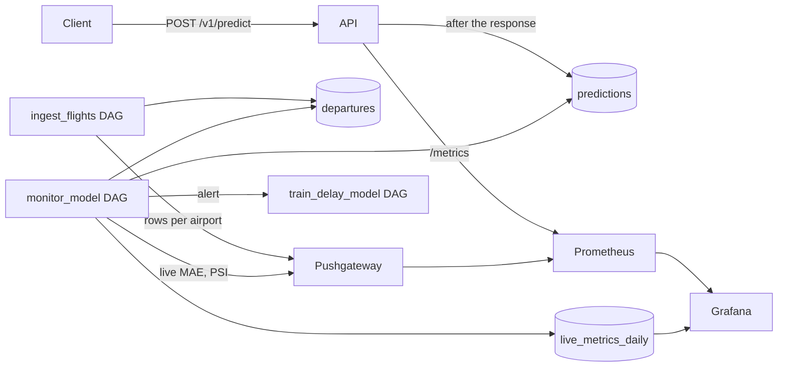

# Monitoring

The scraper collects each flight's actual departure a few hours after the API predicted it, so the
loop can be closed: every prediction is logged, matched to what happened, and compared with the
offline test numbers. Input drift is checked against the training data, and a sustained problem
triggers retraining, which still has to pass the promotion gate.



| Where | What |
| --- | --- |
| Grafana, http://localhost:3000 (`admin`, `GRAFANA_ADMIN_PASSWORD`) | The AeroScrape dashboard: API traffic, latency and errors, predictions per airport, scraper rows, live vs. offline metrics, drift |
| Prometheus, http://localhost:9090 | Raw metrics; `/alerts` shows the alert rules and what is firing |
| Pushgateway, http://localhost:9091 | The last metrics each batch job pushed |
| `reports/monitoring/drift_<date>.html` and MLflow experiment `flight_delay_monitoring` | Drift report per run |

Prometheus tracks the service and a few numbers over time. The model-quality work happens in
Airflow, which pushes only its summary numbers. The daily live metrics also go to a Postgres table,
so the dashboard shows their history directly.

## The prediction log

After each response, the API writes every scored flight to `predictions` in a background task. A
database outage costs only log rows (`prediction_log_failures_total`), never a request. A row holds
the request, the model version, the probability, the 10/50/90% delay range, and the full model
input as JSON, which the drift check reads.

A flight is identified by `airport|flight number|scheduled time`, in the cleaner's normalized
spelling. Requests without a flight number can't be matched to an outcome, but they still count
for drift.

The `X-Traffic-Source` header labels synthetic traffic: `client` (the default), `replay` or
`loadtest`. `make loadtest` sends `loadtest`, which monitoring ignores; `make replay` sends `replay`,
which monitoring treats like real traffic.

The API's database role can only insert into this table. It can't read it back.

## The monitor DAG

`monitor_model` runs daily at 06:30 UTC (10:00 in Tehran, after the night's flights have been
scraped). `make monitor` runs it now.

1. **join_outcomes** matches predictions of flights scheduled more than 3 hours ago to their actual
   delay. The delay comes from the training cleaner and its row selection (departed domestic
   departures with a plausible delay), so a live label means exactly what a training label means.
2. **live_performance** computes, per scheduled day and model version, the MAE of the median, the
   Brier score, the share inside the 10–90% range, the share of flights with no actual time, and
   the share with no inbound aircraft match. Each flight counts once, with its latest prediction.
   A day with fewer than 30 matched flights gets no metrics. The offline numbers come from the
   served version's MLflow run, and both go to `live_metrics_daily` and the Pushgateway.
3. **detect_drift** compares the inputs of the last 7 days with the production model's training
   inputs: a 20,000-row sample rebuilt from its training window with the training code, and stored
   with its MLflow run the first time.
4. **decide_retrain** triggers `train_delay_model` if the MAE was degraded for 3 days in a row or an
   input drifted. Retraining happens at most once in 3 days, and the gate still decides whether the
   new model goes live.
5. **apply_retention** deletes predictions older than 90 days.

All thresholds are in `config.yaml` under `monitoring`.

### Drift

For each input, the Population Stability Index (PSI) compares the share of rows per bin. Numbers are
binned by deciles of the training values. Flags, counts and categories are binned by value, with the
20 most common training values kept and the rest pooled as `(other)`. Missing values are a bin of
their own, because an input that suddenly goes missing is drift too. PSI below 0.1 is stable,
0.1–0.25 is a moderate shift, and 0.25 or more counts as drift. For numbers the report adds the
Kolmogorov–Smirnov p-value, but with thousands of rows it flags even tiny shifts, so the decision
uses PSI.

This replaces Evidently, which would bring dozens of dependencies into the Airflow image for the
same handful of numbers. The ~150 lines in `aeroscrape/monitoring/drift.py` are unit-tested.

## Alerts

`monitoring/alerts.yml`, unit-tested with `promtool` (`make check-monitoring`, also in CI):

| Alert | When |
| --- | --- |
| ApiDown | Prometheus can't scrape the API for 2 minutes |
| ApiHighErrorRate | More than 5% of requests return 5xx for 10 minutes |
| ApiSlowP95 | p95 latency above 500 ms for 10 minutes |
| PredictionLogFailing | Predictions couldn't be logged in the last 15 minutes |
| AirportBoardEmpty | An airport that had flights this week returned no rows |
| ScrapeValidationFailed | The last scrape failed the data contract |
| IngestStale | No successful load for 7 hours (the DAG runs every 3) |
| LiveMaeDegraded | Live MAE more than 25% above offline for 3 days |
| LiveCoverageLow | Under 65% of flights inside the 10–90% range (target 80%) |
| InputDrift | Any input's PSI is 0.25 or more |
| MonitoringStale | The monitor DAG hasn't run for a day |

Alerts show in Prometheus (`/alerts`) and on the dashboard's "Firing alerts" panel. Notifications
(Telegram, Slack) need an Alertmanager. It's not set up yet because it needs a bot token.

## Trying it without real traffic

```bash
make replay DAYS=7          # last week's scraped departures through the API, as live traffic
make monitor                # match outcomes, compute live metrics and drift
make replay DAYS=1 NIGHT=1  # the same flights moved to 00:00-04:59: Scheduled_Hour_of_Day drifts
```

## What the first replay showed

The 619 departures scraped on 2026-11-02 to 11-06, replayed through model version 5 (trained on
2025-05-22 to 06-11):

| Day | Flights | Matched | Live MAE | Offline MAE | Coverage |
| --- | --- | --- | --- | --- | --- |
| 2026-11-02 | 236 | 203 | 21.9 min | 20.2 min | 84% |
| 2026-11-03 | 157 | 0 (no actual times were scraped that day) | — | — | — |
| 2026-11-06 | 112 | 104 | 25.3 min | 20.2 min | 93% |

Accuracy held up a year and a half later. The model's inputs did not:

| Input | PSI | Why |
| --- | --- | --- |
| `airline_delay_rate_7d` | 4.1 | Missing for 38% of recent flights against 7% in training: the database holds a few scattered days, not a continuous week |
| `airline` | 1.0 | 35% of recent flights are on airlines outside the training's 20 most common, against 10% |
| `scheduled_turnaround_min`, `has_inbound` | 0.34, 0.30 | Only 7% of recent flights find their inbound aircraft, against 27% in training |
| `Scheduled_Hour_of_Day` | 0.32 | A different season's timetable |

The drift triggered retraining. Version 6 was trained and the gate rejected it, so version 5 stays
in production. That is the loop working as designed, and these data gaps are what Phase 10
(scraper reliability) has to fix.

The same ingest run also showed 16 of the 34 airport boards returning no rows. AirportBoardEmpty
fires only when an airport that had flights this week goes quiet, so boards that are always empty
don't page anyone.
