# A tour of the running system

Screenshots of the Docker stack on 2026-11-06, taken while Locust and a replay of the week's
scraped flights were sending traffic.

## Demo

The dropdowns offer the values the served model was trained on. The result shows the calibrated
chance of a delay over 15 minutes, the likely delay with its 10–90% range against the 15-minute
line, and the factors behind the probability.

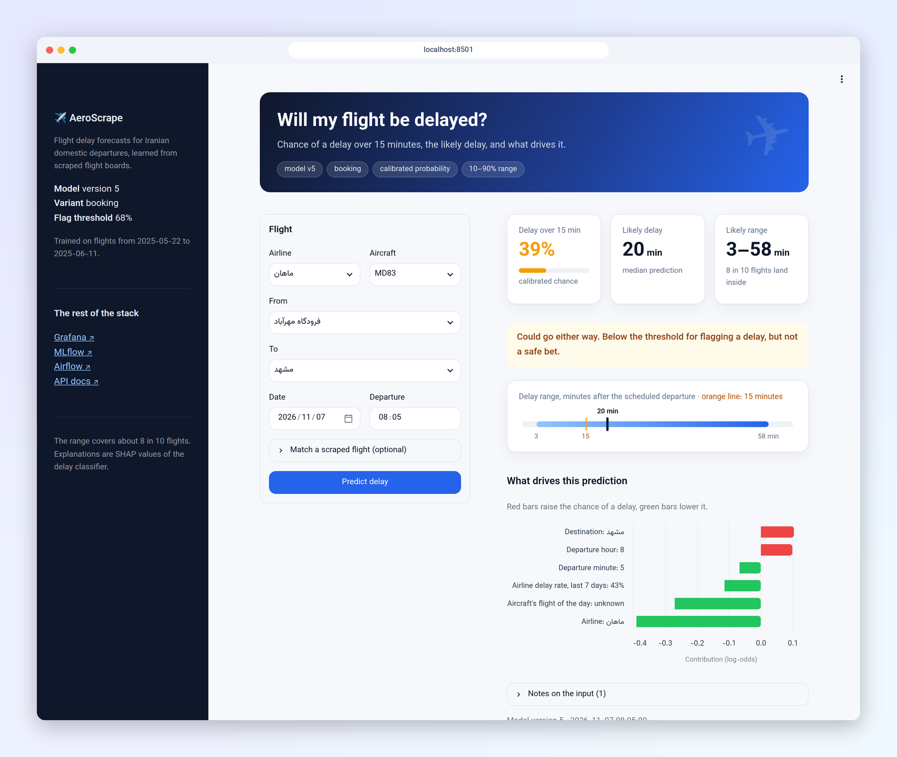

## Monitoring

The Grafana dashboard: API traffic and latency, predictions per airport, scraper rows, live
vs. offline accuracy per day, and input drift. Details in [monitoring.md](monitoring.md).

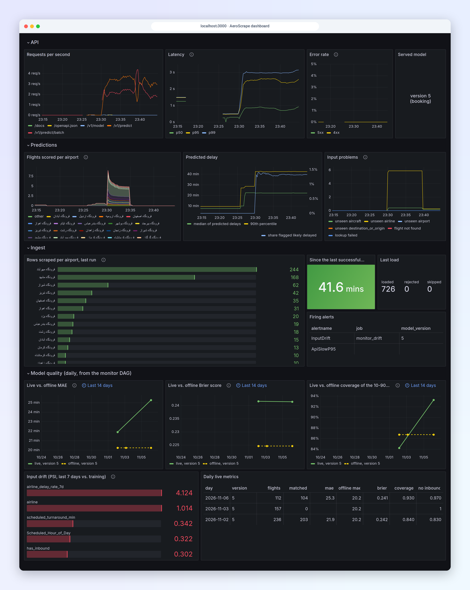

Alert rules in Prometheus. During the load test p95 latency passed 500 ms (`ApiSlowP95` pending),
and the November inputs had drifted from the 2025 training data (`InputDrift` firing).

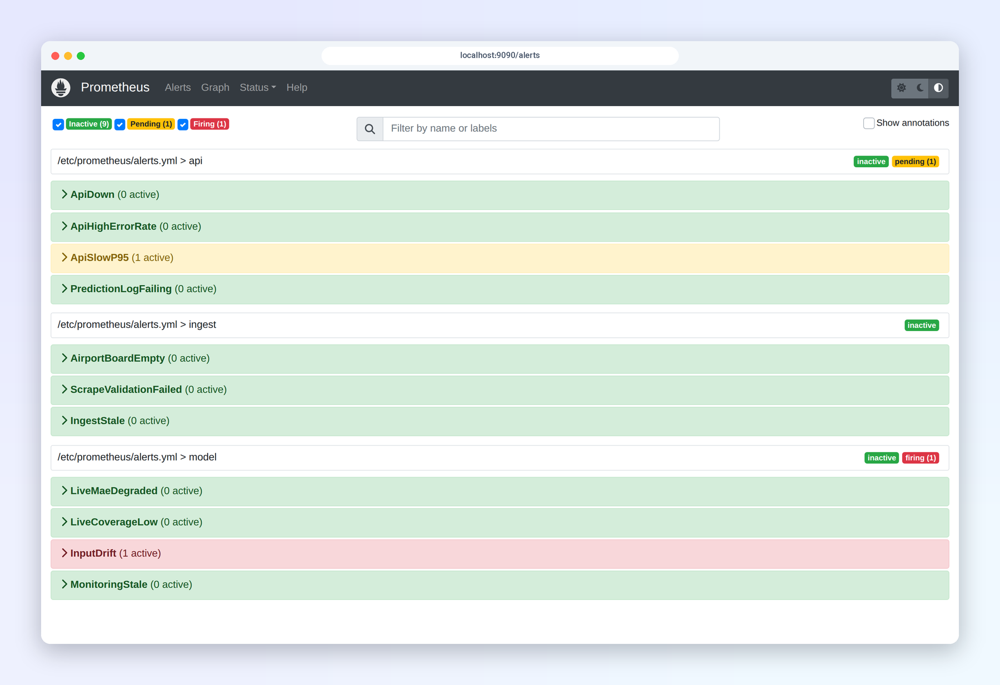

The drift report the monitor DAG writes each day, per input.

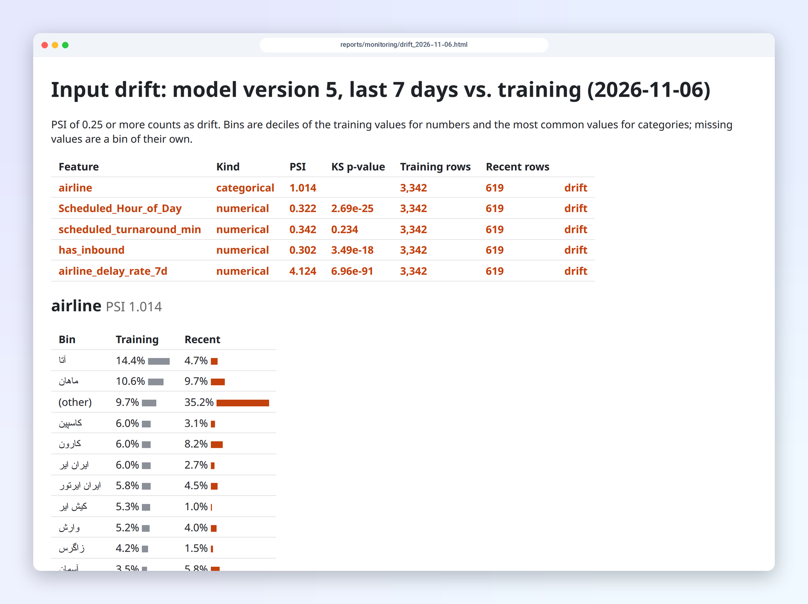

## Orchestration

The three DAGs, and the monitor DAG, which matches predictions to outcomes, checks accuracy and
drift, and can trigger retraining.

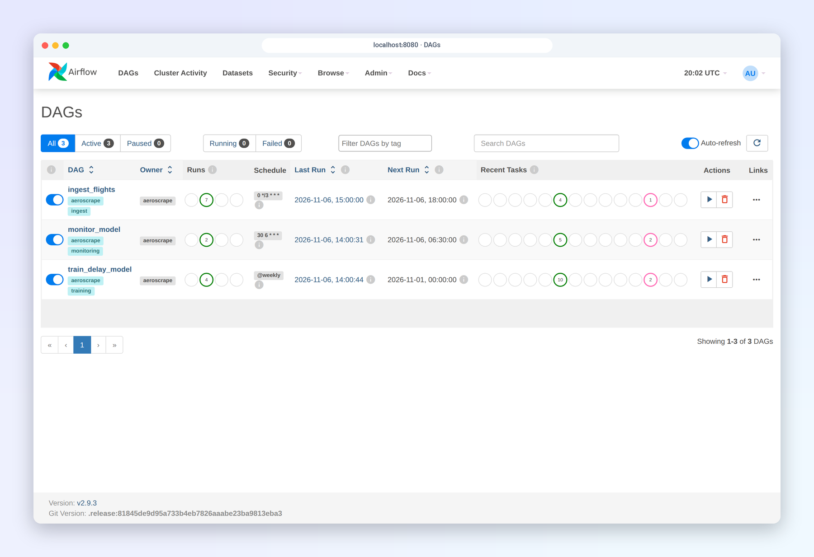

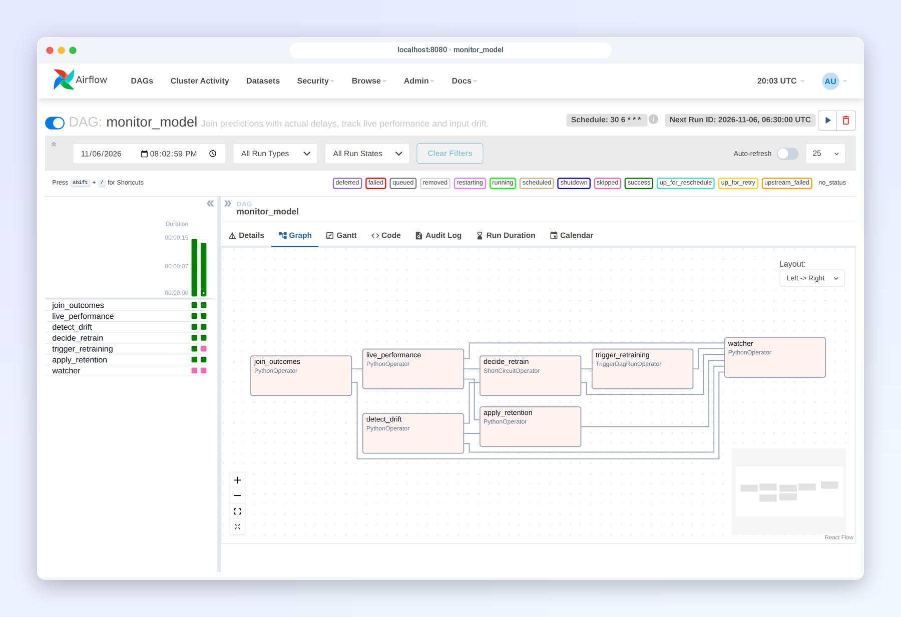

## Models

The registry: each version carries its git commit, training window, data hash and the gate's
decision; aliases mark what serves.

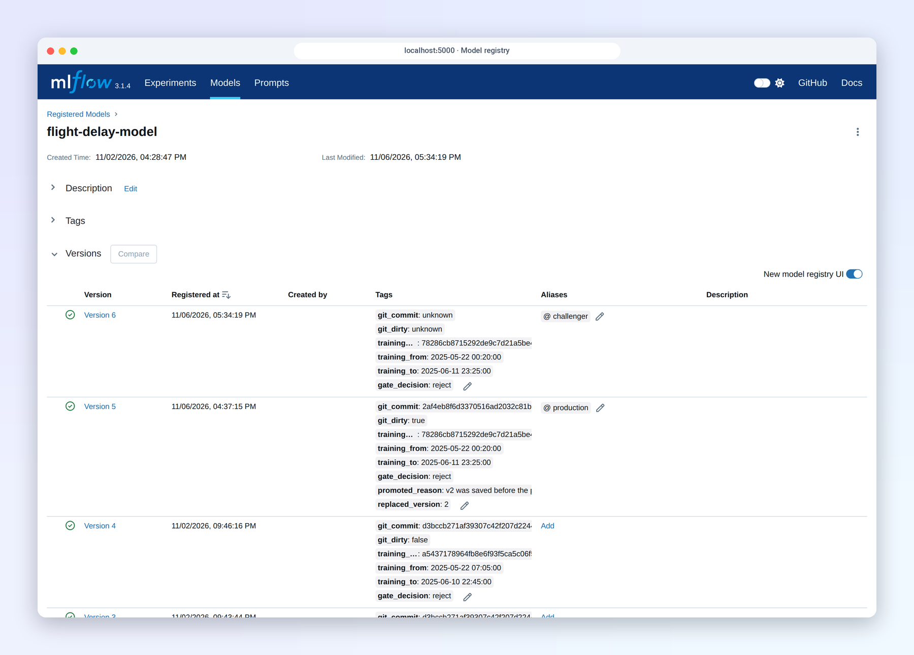

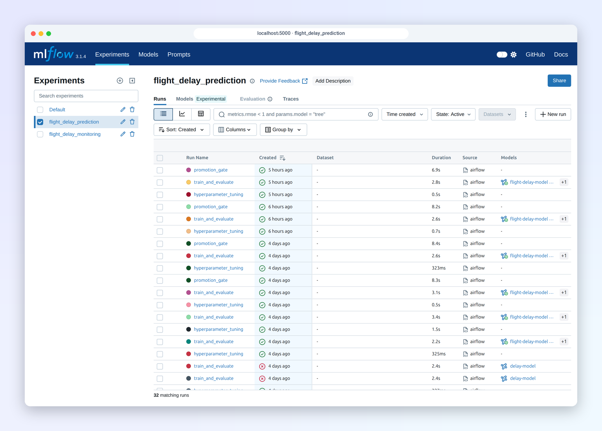

## API

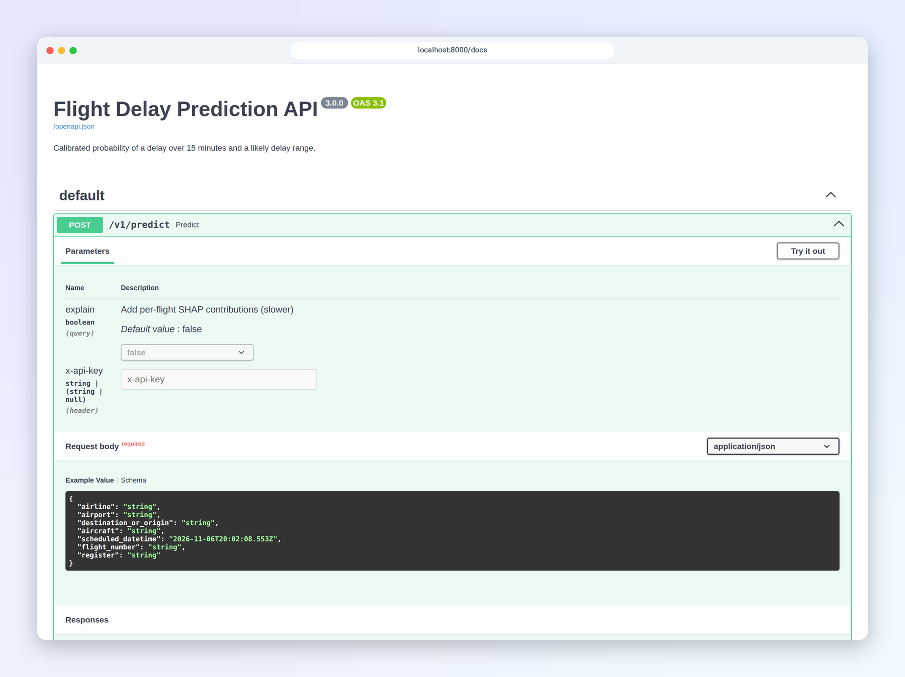

Locust against the API with 6 users and all three scenarios. See [serving.md](serving.md#latency-under-load).

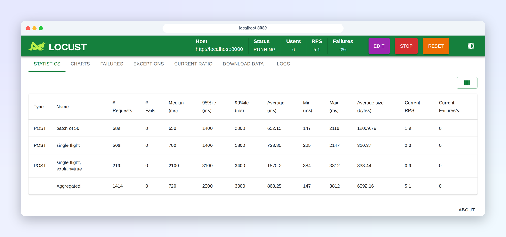

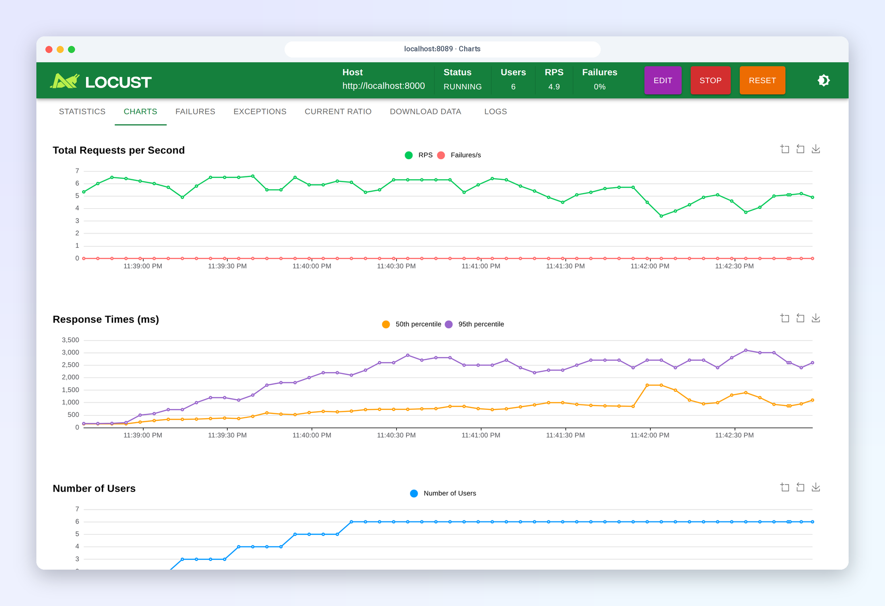
