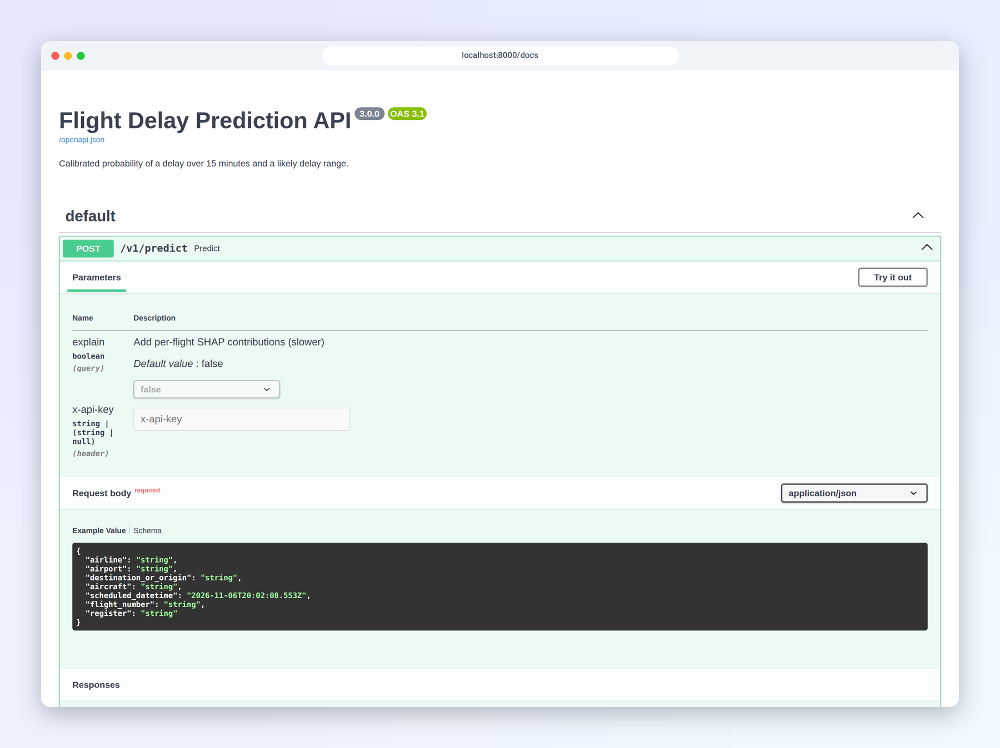
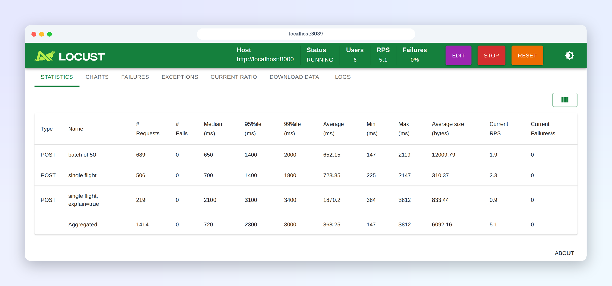
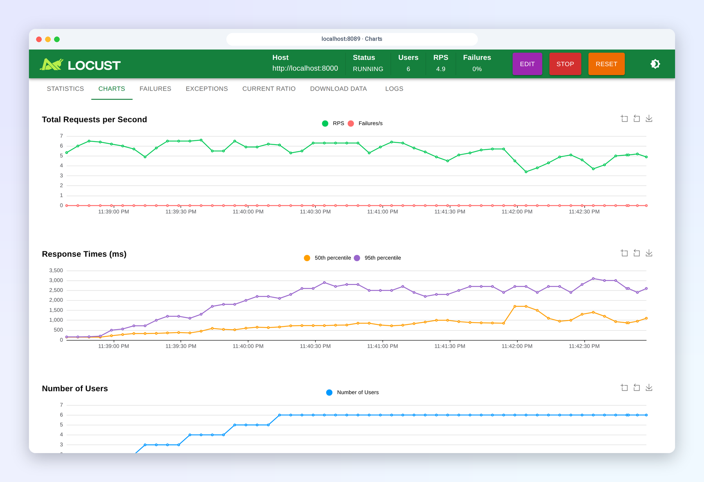

# Serving: one pipeline for training and prediction

The API predicts with the same model artifact and the same feature code that training used. Two things guarantee that: one registered MLflow model, and one feature function.

## One model artifact

`flight-delay-model` is an MLflow pyfunc ([`models/delay_model.py`](../src/aeroscrape/models/delay_model.py)) holding the quantile regressors, the classifier, its calibrator, the conformal margin and the decision threshold. It is logged with an input signature and example, so MLflow rejects input with missing columns or wrong types. The API loads it by alias (`models:/flight-delay-model@production`); nothing is read from local disk. Earlier versions loaded the model from the registry and its preprocessor from `models/preprocessor.joblib`, and the two could silently drift apart.

## One feature function

Training calls `build_features(departures, all_flights)`. For a request, [`serving/feature_lookup.py`](../src/aeroscrape/serving/feature_lookup.py) does the same for one departure:

1. Fetch from Postgres the flights its features look at: domestic departures from the 7 days before its date (rates), and the same day plus the 12 hours before it (rotation, live delays). `Database.fetch_flights` returns them in the raw scraped format.
2. Clean them with the training cleaner, `clean_flights`.
3. If the request names a scraped flight (`flight_number`), use its scraped row, registration included, exactly as training would.
4. Call `build_features(target, context)`.

`tests/test_parity.py` builds features for 50 departures through the training path and through the lookup and asserts they are identical, for both model variants. On the full 2025 dataset the same check passed for 80 departures with no differences.

### A small feature store

Earlier days change rarely, so the cleaned history is cached per date for 15 minutes; the flight's own day is fetched on every request so live delays are current. Measured with the stack on a laptop: about 310 ms per prediction (fetch, clean, features, model and SHAP), about 600 ms for the first request of a day, which fills the cache.

The alternative is a `feature_snapshot` table that Airflow refreshes with precomputed rates and recent arrivals. It would cut request latency, but it is a second copy of the feature logic's output that can go stale or disagree with training. At about 600 flights a day, computing on request is simpler and fast enough; the snapshot becomes worth it if volume or latency requirements grow.

### When information is missing

- A flight that wasn't scraped, or has no registration, gets no rotation or live features; the response lists them in `warnings` and the model's imputer fills them.
- If the database is unreachable, the API falls back to the request's own fields (calendar and identity) and says so in `warnings`. `/health` reports `feature_lookup`.
- The API connects as `aeroscrape_reader`, a role that can only read the flight tables.

## Lineage

Every training run records what it was built from, as MLflow run tags, as tags on the registered model version, in the model's metadata and in the report:

| Tag | Example |
| --- | --- |
| `git_commit`, `git_dirty` | `4a692b13...`, `false` |
| `raw_data_sha256` | hash of the raw CSV |
| `training_data_sha256` | hash of the exact training frame (features and targets) |
| `training_from`, `training_to`, `training_rows`, `test_rows` | 2025-05-22 to 2025-06-09, 2887, 687 |
| `features` | every feature column |
| `airflow_run_id` | the DAG run that trained it |

Containers have no `.git` directory, so `make train` passes the commit and dirty state in the DAG run's conf. A run started from the Airflow UI records `unknown`.

## Run directories

Each DAG run writes its intermediate files (cleaned flights, Parquet splits, tuned parameters, report) to `data/runs/<run_id>/` and passes only paths through XCom. Concurrent runs can't overwrite each other, and the cleanup task removes the directory when the run ends.

## The API contract (v1)

| Route | Purpose | Auth |
| --- | --- | --- |
| `POST /v1/predict` | one flight | `X-API-Key` |
| `POST /v1/predict/batch` | up to 500 flights, scored in one vectorized model call | `X-API-Key` |
| `POST /v1/reload` | check the registry for a newly promoted model now (it is also polled every 2 minutes) | `X-API-Key` |
| `GET /health` | liveness: the process is up | none |
| `GET /ready` | readiness: the model and the feature lookup are loaded (503 otherwise); compose's health check uses it | none |
| `GET /metrics` | Prometheus metrics: requests and latency per route, flights scored per airport, predicted delay and probability, time in the feature lookup, model and SHAP, unseen categories, the served version | none (keep port 8000 off the internet, or put the API behind a proxy that hides it) |



- **Validation.** `scheduled_datetime` is a datetime, strings have length limits and unknown fields are rejected, all with a 422. A value of airline, airport, destination or aircraft that the model never saw in training is accepted, because the model handles it (it ignores the unknown category), but it is listed in `warnings` instead of being silently zeroed as before.
- **Explanations are opt-in.** SHAP doubles the cost of a prediction, so `top_factors` is computed only with `?explain=true`.
- **Errors** return a generic message and the request ID, not the exception text.
- **Prediction log.** Every scored flight is written to the `predictions` table after the response is sent, for [monitoring](monitoring.md). `X-Traffic-Source: replay` or `loadtest` labels synthetic traffic, and monitoring ignores `loadtest`.
- **Security.** Prediction routes require `X-API-Key` when `AEROSCRAPE_API_KEY` is set (compose requires it); the comparison is constant-time. CORS allows only the demo's origin. Secrets come only from environment variables.

## Logs

The API writes one JSON object per line to stdout. Every request gets an ID, taken from the caller's `X-Request-ID` header or generated, and echoed back in the response. Each request is logged once with its method, path, status, latency, model version, number of flights and the mean predicted probability and delay:

```json
{"time": "2026-11-06T13:09:05.766+00:00", "level": "INFO", "logger": "aeroscrape.serving.api", "message": "request", "request_id": "e2e-check-1", "method": "POST", "path": "/v1/predict", "status": 200, "latency_ms": 365.3, "model_version": "5", "flights": 1, "explain": true, "mean_p_delay": 0.532, "mean_p50_minutes": 21.3}
```

Logs are for investigating single requests. Monitoring reads the prediction log and `/metrics` instead (see [monitoring.md](monitoring.md)).

## Latency under load

Measured with `make loadtest` ([Locust](https://locust.io), [`tools/locustfile.py`](../tools/locustfile.py)) against the Docker stack on a 4-core laptop, one uvicorn worker, 30 s per scenario, users sending back to back with no think time, flights for the next day so the feature lookup does its full work:

| Scenario | Users | p50 (ms) | p95 (ms) | p99 (ms) | Requests/s | Flights/s |
| --- | --- | --- | --- | --- | --- | --- |
| single flight | 1 | 100 | 140 | 180 | 9.3 | 9 |
| single flight, `explain=true` | 1 | 210 | 290 | 320 | 4.5 | 4 |
| batch of 50 | 1 | 140 | 180 | 220 | 6.9 | 346 |
| single flight | 8 | 1,000 | 1,200 | 1,200 | 7.7 | 8 |
| single flight, `explain=true` | 8 | 1,800 | 2,400 | 3,100 | 4.3 | 4 |
| batch of 50 | 8 | 1,400 | 1,600 | 1,800 | 5.7 | 285 |




The screenshots are from a separate run, with the three scenarios together and 6 users. No request failed. A prediction costs about 100 ms of CPU, most of it the feature lookup and model; at concurrency 8 requests queue behind one worker, so latency grows while throughput stays flat. Two consequences:

- **Batch when you can.** Scoring 50 flights takes 1.4 times as long as scoring one, so batch throughput is about 35 times higher.
- **Scale out with workers.** The service is CPU-bound and stateless apart from the loaded model, so more uvicorn workers (one per core, each with its own copy of the model) or more replicas raise throughput roughly linearly.

`make loadtest USERS=16 LOADTEST_SECONDS=60` changes the load; the raw Locust CSVs land in `reports/locust/`. To watch a run live, export `AEROSCRAPE_API_KEY` and start Locust's web UI with `uv run locust -f tools/locustfile.py --host http://localhost:8000` and open http://localhost:8089.

## Docker images

One Dockerfile builds one slim image per role, each with only the extras it needs:

| Image | Used by | Size |
| --- | --- | --- |
| `aeroscrape/core` | MLflow server, scraper | 0.9 GB |
| `aeroscrape/api` | API | 1.2 GB |
| `aeroscrape/demo` | Streamlit demo | 1.0 GB |
| `aeroscrape/airflow` | Airflow webserver and scheduler | 1.3 GB |

Before, every service ran one 1.4 GB image with everything in it, as root.

- **Multi-stage.** A builder stage installs the locked dependencies with uv; the runtime stage copies only the virtualenv and the installed package.
- **Non-root.** Containers run as `app` with your user and group IDs (1000 by default), so files they write into `mlruns/`, `logs/` and `data/` are yours. `make fix-permissions` hands back files that older root containers wrote.
- **Code comes from the image.** Source is no longer mounted into containers, so `make up` rebuilds and recreates a container when its code changes; a container can no longer keep running stale code.
- **No fixed container names.** Containers are named by compose (`aeroscrape-api-1`), so a second checkout or test stack can't collide with the real one.
- **Offline builds.** When PyPI is unreachable, `make build-offline` builds the same images from the local uv cache: a throwaway container bind-mounts the cache, installs the locked packages into a virtualenv, and the `runtime-prebuilt` target copies it in. `make up-offline` then starts the stack without building.

### Models must not depend on the training image

Splitting the images exposed a hidden coupling. Airflow loads `dill`, which installs its own savers in Python's pure-Python pickler; joblib uses that pickler, so models saved in a training task depended on `dill` to load, and the slim API image couldn't load them (`No module named 'dill'`). The model is now saved with the C pickler, which `dill` doesn't affect, and `tests/test_delay_model.py` checks that a model saved with `dill` active contains no reference to it. Versions saved before the fix (up to version 4) load only where `dill` is installed, so version 5, trained with the fix and found equivalent to version 2 by the gate, was promoted with that reason recorded on it.
